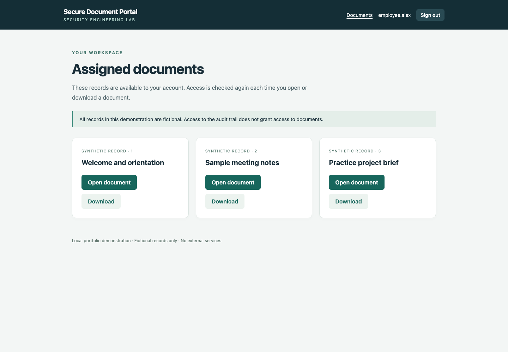
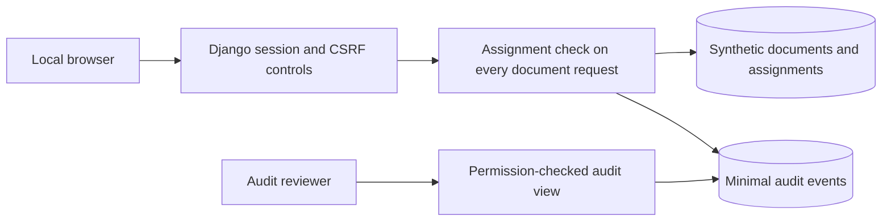

# Secure Document Portal

[](https://github.com/uspharaoh93/secure-document-portal/actions/workflows/ci.yml)

A working Python/Django portfolio project that demonstrates **document-level authorization** and **audit logging without sensitive payloads**. Employees can open and download assigned documents; a separate reviewer can inspect access decisions without automatically receiving document access.

This is an independent educational build. All accounts and records are fictional. It contains no source code or customer information from a private application.



## What to review

- [Security study](docs/security-study.md): two hypothetical flaws, exploitation paths, CIA impact, fixes and regression evidence.
- [Tests](tests/test_portal.py): requests that try to cross account boundaries, bypass direct downloads, read logs, retain revoked access or leak sensitive values.
- [Pipeline](.github/workflows/ci.yml): tests, real browser checks, static analysis, dependency audit, full-history secret scan and a gated source artifact.
- [Verification record](docs/verification.md): what has actually been checked and where the evidence lives.
- [Development case study](https://github.com/uspharaoh93/secure-development-case-study): a separate public account of engineering methods and their limits.

## Run locally

Requirements: Python 3.14 and Git. Tested on macOS; GitHub Actions checks Linux. Commands below use a POSIX shell.

1. Clone and install the pinned application dependencies:

   ```sh
   git clone https://github.com/uspharaoh93/secure-document-portal.git
   cd secure-document-portal
   python3.14 -m venv .venv
   source .venv/bin/activate
   python -m pip install --require-hashes -r requirements.txt
   ```

2. Generate local accounts, passwords and fictional records:

   ```sh
   python scripts/setup_demo.py
   ```

   Open `.local-data/credentials.json` locally to read the generated passwords. Do not publish this file. The usernames are `employee.alex`, `employee.jordan` and `reviewer`. Each employee has three documents. The reviewer has audit access and no assigned documents. Setup is repeatable and does not reset existing accounts.

3. Start the local server and open [the portal](http://127.0.0.1:8000):

   ```sh
   python manage.py runserver 127.0.0.1:8000 --noreload
   ```

4. Follow the [five-minute walkthrough](docs/demo.md), then stop the server with Ctrl+C.

## Run the checks

```sh
python -m pip install --require-hashes -r requirements-dev.txt
python scripts/check.py
python -m playwright install chromium
python scripts/browser_check.py
python scripts/recovery_check.py
```

On Linux, Playwright may require `python -m playwright install --with-deps chromium`. The browser check starts and stops its own server. The recovery check restores into a temporary database without overwriting the running database. [Operations and recovery instructions](docs/operations.md).

## Design and limits



This diagram describes only this public demonstration. Documents are plain text stored in SQLite. There are no uploads, public hosting, external services or AI calls. Login throttling, MFA, TLS termination, tamper-resistant logging and production deployment are not implemented. The server must remain on loopback. See [security limitations](SECURITY.md).

The implementation and documentation were developed with AI-assisted coding tools. Runnable checks and source code are provided so readers can assess the work directly. Tool output is evidence for the tested cases, not proof that the application has no vulnerabilities.

## License

MIT for the original material in this repository. Referenced projects retain their own licenses. No rights to any private application are granted.
