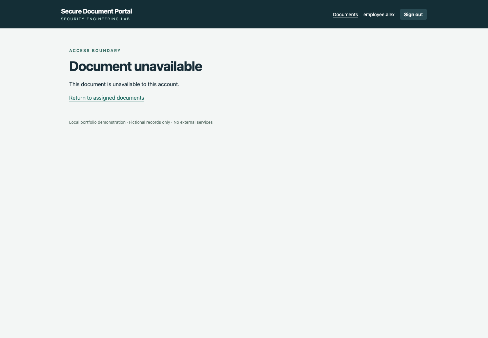
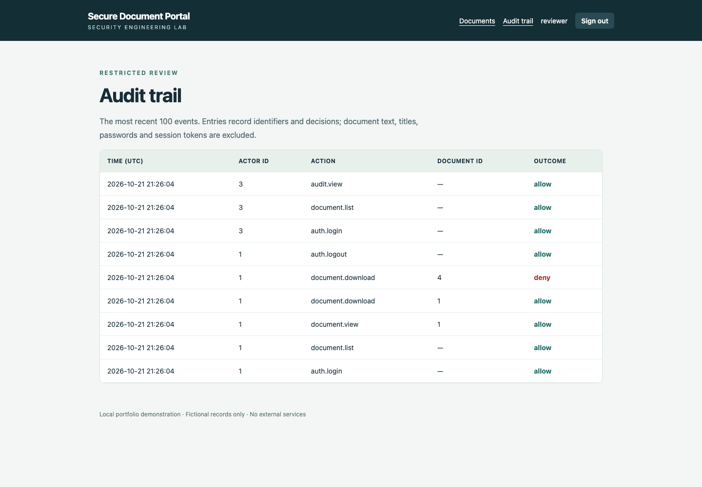

# Five-minute walkthrough

1. Run setup and start the loopback server using the README. Read the generated passwords from the private local credentials file.
2. Sign in as `employee.alex`. Open a record and download it. Confirm that the page and file contain fictional training text.
3. In a fresh seeded database, visit `/documents/4/`, then `/documents/4/download/`. Both must return an unavailable page because record 4 belongs to the other employee. The numeric example assumes the initial six seeded records; the test suite creates its own records independently.
4. Visit `/audit/` while still signed in as Alex. Expect access denied.
5. Sign out. Sign in as `reviewer`. Confirm that the document list is empty. Open **Audit trail** and find the allowed view/download events and denied access attempts. The trail should contain identifiers and outcomes, not document titles or text.
6. Resize the browser to a narrow phone viewport. The document cards should fit without horizontal scrolling.
7. Run `python scripts/recovery_check.py`. It verifies a backup and restored copy without replacing the live database.

The reviewer's permission is intentionally separate from document assignments. The demo has no administrative editing interface; account provisioning is performed by the local setup command.
